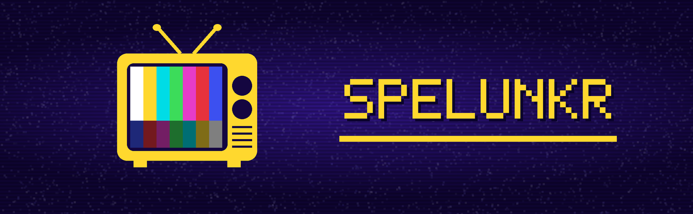
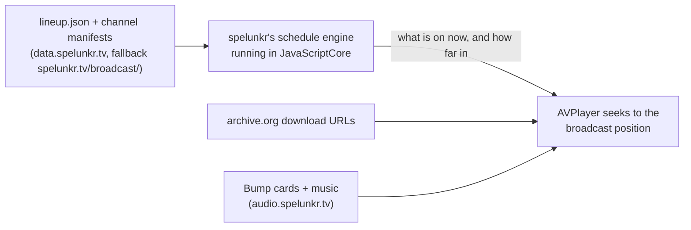

<p align="center">
  
</p>

# spelunkrtv-apple-tv

**Cable TV, but weirder, on your Apple TV.** An unofficial tvOS app for [spelunkr.tv](https://spelunkr.tv), the free site that turns forgotten Internet Archive videos into 37 synchronized, 24/7 "cable" channels. Every channel lands on the same tape at the same second as the website.

> **Unofficial.** This project is not affiliated with, endorsed by, or sponsored by spelunkr.tv. Spelunkr's own site lists Apple TV as unsupported (its official app targets Android TV, Google TV and Fire TV). This is an independent hobby project that fills that gap.
>
> All programming streams from the [Internet Archive](https://archive.org). Please consider [donating to the Internet Archive](https://archive.org/donate) and [supporting spelunkr on Ko-fi](https://ko-fi.com/spelunkrtv). Questions about spelunkr itself belong on the [spelunkr Discord](https://discord.gg/QhtW9DcRR3). If you plan to distribute this app publicly (TestFlight links, App Store, shared builds), ask spelunkr's creator first.

## Features

- A TV-sized channel guide with a live preview, a scrollable program grid, and details for upcoming shows
- Nine selectable themes, with your choice saved on the Apple TV
- Live viewer counts for each channel and across the guide, shared with the website
- Same schedule as the website: your TV and the browser show the same tape at the same moment
- Live-TV channel surfing with the Siri Remote (up and down to change channels)
- Bump and station-ID cards between shows, with spelunkr's music
- Overlay music channels (such as Vacation Slides), including the faint projector hum
- Picture fixes from the site: squeezed tapes are stretched back to their real shape, and tapes with a baked-in black border are zoomed to fill the screen
- Frame-rate and dynamic-range matching: if Match Content is on in the Apple TV settings, the TV switches to each tape's frame rate and range (some TVs blank briefly while switching)
- A status screen when a channel has nothing scheduled or a tape will not play, followed by a new tune at the next show

## How it works



- **Lineup and schedules:** the app loads `lineup.json` and a manifest per channel from `data.spelunkr.tv`, falling back to `spelunkr.tv/broadcast/` if that fails.
- **Same schedule as the website:** the site's own schedule engine runs inside JavaScriptCore (Apple's built-in JS engine), so "what is on right now, and how far into it" is computed exactly the way the site does it.
- **Playback:** AVPlayer opens the current show and seeks to the broadcast position. While it plays, the app checks once a second and quietly re-seeks if the picture drifts more than 3 seconds from the broadcast clock (at most once every 20 seconds). A "TRACKING..." label shows while the tape buffers.
- **Video source:** The app streams Internet Archive tapes directly. When item metadata identifies a storage server, the app uses that direct URL for playback.
- **Viewer counts:** the app reads the site's live viewer counts and reports the active channel using the site's heartbeat protocol.
- **Bumps and station IDs:** between shows, cards (channel name, slides, SPELUNKR, "up next") appear with music from `audio.spelunkr.tv`, timed like the site's own cards.
- **Overlay music:** on channels such as Vacation Slides, the tapes are silent and a playlist of public-domain tracks plays over them, plus a faint projector hum. The playlist is shuffled with the site's seeded generator, so you hear the same track at the same moment as everyone else. If a track will not play, the app moves to a stand-in like the site does.
- **Picture fixes:** `AspectFixes.swift` loads the site's `stretch.json` and `zoom.json`. It also downloads `crop43.json`, which only matters for the site's optional CRT mode, so the app does not apply it.

## Requirements

- A Mac with **Xcode and the tvOS 27 SDK** for development and testing
- **Node.js 18 or newer** (to generate the schedule engine, see below)
- An Apple ID (a free one is fine)
- The Apple TV simulator, or an Apple TV HD / Apple TV 4K on **tvOS 17 or later**

## Quick start

1. **Clone the repository.**

   ```sh
   git clone https://github.com/bradenqueen/spelunkrtv-apple-tv.git
   cd spelunkrtv-apple-tv
   ```

2. **Generate the schedule engine.** Do this before building; without it the app builds but cannot tell what's on.

   ```sh
   node tools/update-engine.mjs
   ```

   The script downloads spelunkr.tv's current JavaScript, extracts its schedule engine, smoke-tests it against the live lineup, and writes `SpelunkrTV/Engine/spelunkr-engine.js.txt`.

   **Why is this a separate step?** That file contains code copied from spelunkr.tv's own bundle, which is not under a license that allows redistribution, so it is deliberately not committed to this repository. Generating it locally also means you always get the version that matches the live site.

3. **Fetch the guide fonts (optional).** Install a WOFF2 converter with `npm install --no-save wawoff2`, or install `fonttools` and `brotli` in your Python environment. Run the font script from the repository root.

   ```sh
   node tools/fetch-fonts.mjs
   ```

   The script writes the site's Star4000 and Star3000 fonts to the Git-ignored `SpelunkrTV/Fonts/` folder. The app uses system fonts when those files are absent.

4. **Open the project in Xcode and run it.**
   1. Open `SpelunkrTV.xcodeproj`.
   2. Select the **SpelunkrTV** target, then **Signing & Capabilities**.
   3. Choose a **Team** (a free personal Apple ID team works). If Xcode says the bundle identifier is taken, change it to something unique (the project currently uses `net.zerph.spelunkrtv`).
   4. Pick an Apple TV simulator as the run destination and press Run. Try the simulator first.

If the app starts but says "The schedule engine is missing from the app", step 2 was skipped or the file was not generated.

## Installing on a real Apple TV

1. On the Apple TV: **Settings > Remotes and Devices > Remote App and Devices**. Leave that screen open.
2. In Xcode: **Window > Devices and Simulators**. Your Apple TV should appear under Discovered (it must be on the same network). Click it, then enter the code shown on the TV.
3. Select the Apple TV as the run destination and press Run.
4. If prompted, enable **Developer Mode** on the Apple TV (newer tvOS versions require it) and restart when asked.

| | Free Apple ID | Apple Developer Program ($99/year) |
|---|---|---|
| App validity | Expires after 7 days; re-run from Xcode to refresh | 1-year provisioning |
| Number of apps | Limited | Much higher |
| Installing without Xcode | No | Yes, via TestFlight |

## Remote controls

**Guide**
- Move up or down between channels and left or right through the schedule
- Select a live program to watch it, or select an upcoming program to see its details
- Press Play/Pause to jump to what's on now for the highlighted channel
- Press Up from the first grid row to reach WATCH. Press Down from the top controls to return to the live program
- Open **Theme Mode** in the guide controls to choose a theme. **Cable Guide** uses a two-hour grid and a classic tuning display. In that theme, open **Settings** to switch themes or toggle CRT scanlines.
- Daylight, Cinema, Channel Wall, Schedule Desk, Large Print, and Spotlight offer different ways to browse. Use **Full Guide** for the timeline, then **Back to Browse** or Menu/Back to return.
- From View Channel or Theme Mode, use **Back to Guide** or Menu/Back to return to the control you came from
- Menu/Back from the main guide: leave the app

**Watching**
- Up / down: change channel (up = next higher channel number, wrapping around)
- Left / right, click or Play/Pause: show the info banner (channel, title, time left, what is next)
- Menu/Back: return to the guide or browse screen you left. After changing channels, focus moves to the playing channel on that screen.

## Keeping in sync when spelunkr changes

If spelunkr changes its schedule format, the guide shows an **orange warning**. To fix it, re-run the generator and rebuild:

```sh
node tools/update-engine.mjs   # Node 18+
```

The script re-extracts the engine from the live site, smoke-tests it against the live lineup (the first six channels, plus every overlay-music channel, whose playlist code is cross-checked against the site's), and rewrites `SpelunkrTV/Engine/spelunkr-engine.js.txt`.

If the script reports a new engine number, also raise `supportedEngine` in `SpelunkrTV/BroadcastStore.swift` so the warning goes away. Then rebuild in Xcode.

The file ends in `.txt` so Xcode copies it as a plain resource instead of trying to compile it as source. The app reads it at runtime and hands it to JavaScriptCore.

## Playback and focus logs

Filter the Xcode console for the `tune` category in the `net.zerph.spelunkrtv` subsystem. Tune steps use the format `[channel +elapsedMs] step`. Instruments also records tune milestones as signposts. Enable debug messages to see `[focus]` entries for remote moves and guide focus changes.

## Project layout

| Path | What it does |
|---|---|
| `SpelunkrTV/SpelunkrTVApp.swift` | App entry point, audio session, root view (guide, player or static screen) |
| `SpelunkrTV/Models.swift` | Data types for the lineup, channels, what is on air, overlay music and guide entries, plus small helpers |
| `SpelunkrTV/BroadcastStore.swift` | Fetches lineup and manifests (with fallback), feeds the engine, keeps the guide fresh, holds app state |
| `SpelunkrTV/ScheduleEngine.swift` | Runs the site's schedule engine in JavaScriptCore |
| `SpelunkrTV/TVPlayer.swift` | Playback: tuning, seek to broadcast position, drift correction, card music, overlay music, projector hum, Internet Archive URLs |
| `SpelunkrTV/TapeLoader.swift` | Fetches and caches MP4 metadata and streams media through HTTP byte ranges |
| `SpelunkrTV/TapeWarmer.swift` | Prepares likely upcoming tapes and retains recently used ones for quicker tuning |
| `SpelunkrTV/TuneLog.swift` | Tune timing logs, Instruments signposts, and guide focus debug messages |
| `SpelunkrTV/AspectFixes.swift` | The site's stretch / zoom maps and the geometry that applies them |
| `SpelunkrTV/PresenceClient.swift` | Live viewer counts and active-channel heartbeats |
| `SpelunkrTV/Theme.swift` | Built-in theme catalog, shared styling, and retro font registration |
| `SpelunkrTV/Views/GuideHome.swift` | Guide preview, channel and program details, and Watch controls |
| `SpelunkrTV/Views/GuideGrid.swift` | Time grid, program cells, and Siri Remote focus navigation |
| `SpelunkrTV/Views/PlayerScreen.swift` | Full-screen playback, channel changing, info banner, video layer |
| `SpelunkrTV/Views/BumpCardView.swift` | Bump and station-ID cards, and the static screen |
| `SpelunkrTV/Engine/spelunkr-engine.js.txt` | The extracted site schedule engine (generated locally, not in git) |
| `SpelunkrTV/Fonts/` | Optional guide fonts (generated locally, not in Git) |
| `SpelunkrTV/Assets.xcassets` | App icon, Top Shelf images, accent color |
| `tools/update-engine.mjs` | Downloads, extracts and tests the engine from the live site |
| `tools/fetch-fonts.mjs` | Downloads the guide fonts and converts them from WOFF2 to TTF |
| `tools/glue.js` | Glue code that exposes the engine to Swift (what is on now, the guide, overlay music); bundled into the generated engine file |
| `docs/` | Project notes and README artwork |

To add a built-in appearance, define it in `Theme.swift` with a new stable ID and add it to `Theme.catalog`. The picker reads that catalog directly.

## Known limitations

- The app depends on spelunkr's **unofficial, undocumented data feeds**, which can change at any time.
- Some old Internet Archive uploads use formats Apple TV cannot play. The app shows a card and waits for the next show.
- Cold tunes can take longer while the app loads a tape's MP4 metadata from the Internet Archive.
- No on-screen playback controls: live TV cannot be paused or scrubbed.
- No Chromecast or AirPlay controls.

## Credits

- **[spelunkr.tv](https://spelunkr.tv) and its creator** for the channels, the schedule engine, the curation and the idea. Join the [spelunkr Discord](https://discord.gg/QhtW9DcRR3) and support them on [Ko-fi](https://ko-fi.com/spelunkrtv).
- **The [Internet Archive](https://archive.org)** and the people who uploaded and preserved every tape. [Donate here](https://archive.org/donate).
- **The bumper music artists** credited in spelunkr's own data, whose tracks play on cards and overlay channels.

Built by Braden Queen ([@bradenqueen](https://github.com/bradenqueen), [bradenqueen.com](https://bradenqueen.com)).

## License

The code in this repository is released under the [MIT License](LICENSE) (c) 2026 Braden Queen. The license covers this repository's code only. It does not cover spelunkr.tv's code or data (which `tools/update-engine.mjs` downloads), the Internet Archive's media, or the bumper music.
